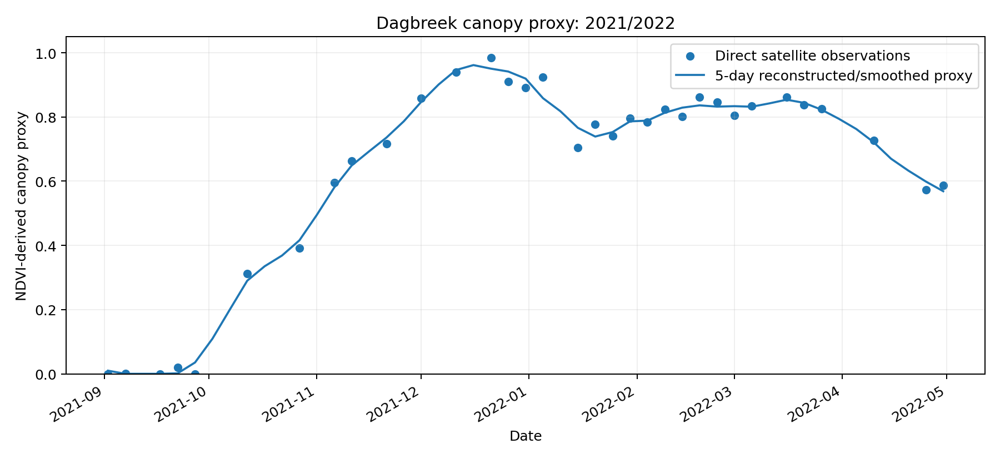
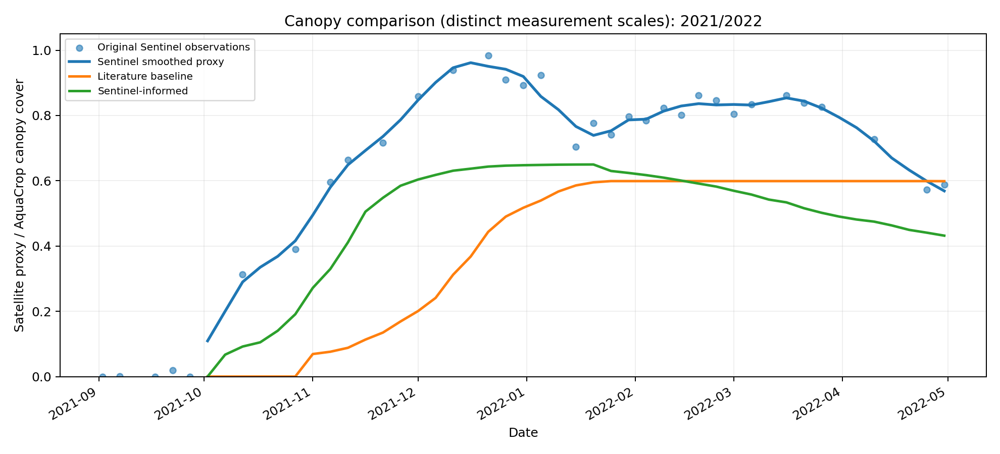
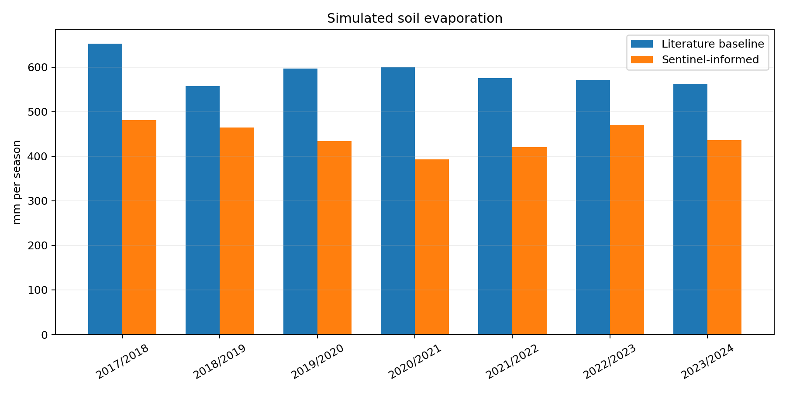

# A Sentinel-2 to AquaCrop-OSPy Pipeline for Table Grapes in the Hex River Valley

**BSc (Hons) Computer Science research project · University of the Western Cape · 2026**

This repository contains a reproducible Python workflow that converts **Sentinel-2 satellite observations** into season-specific grapevine development indicators and incorporates those indicators into **AquaCrop-OSPy**, a process-based crop–water simulation model. The study compares a literature-based grapevine configuration with a Sentinel-informed configuration across seven growing seasons in the Hex River Valley, Western Cape, South Africa.

**Study focus:** Simulated canopy development and water dynamics—not grape yield forecasting or operational irrigation recommendations.

## 1. Motivation, problem and research question

The timing of grapevine canopy growth affects the balance between water transpired through plants and water evaporated directly from soil. AquaCrop requires crop-development parameters, but timing drawn from a published vineyard study may not reproduce the seasonal greenness pattern observed at another location.

**Research question:** *How does integrating Sentinel-2-derived seasonal phenological timing into AquaCrop-OSPy affect simulated table-grape canopy development and water dynamics relative to a literature-based baseline?*

The study tests whether season-specific satellite indicators can make simulated seasonal canopy trajectories more consistent with the satellite-derived greenness proxy. It **does not** assume that this agreement proves field-level model accuracy.

### Research objectives

1. Preprocess NASA POWER and Sentinel-2 inputs.
2. Construct a vineyard-scale canopy-related time series.
3. Infer phenological events and thermal time.
4. Compare literature-based and Sentinel-informed grape configurations.
5. Assess canopy agreement and indicative simulated water fluxes.

## 2. Study area and data

The case study is an approximately **3.24 ha** vineyard analysis polygon associated with **Dagbreek / Modderdrift**, in the **Hex River Valley, Western Cape**. The site was selected within an established South African table-grape region and provides a consistent, bounded spatial unit for analysing repeated satellite observations. These results are **case-study-specific**, not an evaluation of every vineyard in the valley.

| Input | What is used | Role in the pipeline |
|---|---|---|
| Sentinel-2 Level-2A imagery | 219 archived acquisition dates across seven September–April growing seasons (2017/18–2023/24) | Vegetation indices and seasonal canopy-related timing |
| NASA POWER | 5,479 regional daily weather records (2010–2024) | Temperature, precipitation, radiation and reference evapotranspiration inputs |
| Vineyard polygon | One approximately 3.24-ha selected block | Spatial averaging of satellite observations |
| Model scenarios | Assumed sandy-loam soil, initial soil water and irrigation management | Common simulation conditions for each paired comparison |

**Spatial caveat:** NASA POWER weather represents a regional grid, not an instrumented weather station at the vineyard. The satellite block polygon contains precise location data; **do not make this repository public until permission to share it is confirmed**.

## 3. Scientific foundation and contribution

[AquaCrop](https://www.fao.org/aquacrop/) describes crop development, soil-water balance and crop water use through a process-based model. [AquaCrop-OSPy](https://doi.org/10.1016/j.agwat.2021.106976) provides a Python implementation suited to repeatable experiments.

[Er-Raki et al. (2021)](https://doi.org/10.1016/j.agwat.2020.106585) adapted AquaCrop to table grapes in arid Mexico. This study uses that **crop-specific modelling precedent** as the basis for a literature-based configuration. It does not claim that the published parameters are field-calibrated for the Hex River Valley.

**Contribution:** An auditable process for deriving season-specific phenological timing from Sentinel-2 and comparing paired AquaCrop-OSPy configurations under matched environmental assumptions. The study did not develop a new crop model.

## 4. Methodology

```text
Sentinel-2 imagery ──> quality screening ──> NDVI / relative greenness
                                                  │
                                                  v
                           interpolation + smoothing + phenology events
                                                  │
                                                  v
NASA POWER weather ──> reference ET + daily GDD ──> thermal-time milestones
                                                  │
                                                  v
                                    Two AquaCrop-OSPy configurations
                                    (literature | Sentinel-informed)
                                                  │
                                                  v
                                    7 growing seasons × 2 = 14 runs
                                                  │
                                                  v
                              Canopy evaluation + simulated water dynamics
```

### 4.1 Satellite processing

Archived Sentinel-2 surface reflectance is screened for cloud and poor-quality pixels. The processing record specifies a 30% scene-level cloud threshold and a pixel-level scene-classification mask. Spectral indices include NDVI and supplementary vegetation indices.

The principal canopy-related signal is **NDVI**:

$$
\mathrm{NDVI} =
\frac{\rho_{\mathrm{NIR}}-\rho_{\mathrm{red}}}
{\rho_{\mathrm{NIR}}+\rho_{\mathrm{red}}}
$$


To compare seasons on a consistent relative scale, block-mean NDVI is scaled using the pooled 5th and 95th percentiles:


$$
P(t) = \operatorname{clip}\left(
\frac{\mathrm{NDVI}(t)-q_{0.05}}
{q_{0.95}-q_{0.05}},
0,1
\right)
$$


**Important:** \(P(t)\) is a *relative greenness/canopy-related proxy*; it is **not** directly measured fractional grapevine canopy cover. Soil, shadows and inter-row plants may influence the signal.

### 4.2 Reconstruction and seasonal development indicators

Satellite acquisitions are irregular. The processing stage interpolates the original observations to a **five-day grid** and applies a **seven-point, second-order Savitzky–Golay filter**. Reconstructed points are estimates, not additional satellite observations.

Operational rules identify early green-up, full green-up, peak greenness and the onset of seasonal decline. These are satellite-derived **land-surface phenology indicators**, not field-confirmed budbreak dates. Missing observations can affect event timing; the 2017/18 record contains a **50-day maximum observation gap**.

An example from the archived pipeline:



### 4.3 Weather and growing degree days (GDD)

NASA POWER weather is prepared for AquaCrop-OSPy. The implementation uses **RefET** to calculate reference evapotranspiration and accumulates thermal time using:


$$
T_{\mathrm{mean}} = \frac{T_{\max}+T_{\min}}{2}
$$

$$
\mathrm{GDD}_d =
\max\left(0,\min(T_{\mathrm{mean}},35)-10\right)
$$


Temperatures are in degrees Celsius. **10°C** and **35°C** are the implemented base and upper temperatures; they are modelling choices, not independently measured vineyard thresholds. Cumulative GDD connects satellite-estimated event dates to the model's crop-development timing inputs.

### 4.4 Paired AquaCrop-OSPy simulations

Each season is simulated using **two configurations**:

- **Literature-based baseline:** A grapevine parameterisation informed by Er-Raki et al. and the project's working parameter register.
- **Sentinel-informed:** Uses the same general crop setup but adjusts selected canopy-development timings using satellite-estimated green-up, peak and decline expressed as thermal time.

Both configurations use **matched weather, soil, initial soil water and irrigation assumptions within each season**, so the intended difference is the treatment of crop-development timing. AquaCrop-OSPy simulates canopy behaviour and water-balance components, including transpiration, soil evaporation, irrigation, evapotranspiration, drainage and runoff.

The crop configuration explicitly uses **`Kcb = 1.10` as a working modelling assumption**. Its source has **not** been verified against the original Er-Raki paper; it is not presented as a confirmed published or locally calibrated value. See [`config/parameter_provenance.csv`](config/parameter_provenance.csv).

### 4.5 Evaluation

The daily simulated canopy trajectories are compared with the satellite-derived proxy using:

- **RMSE:** Root mean square error; penalises larger departures.
- **MAE:** Mean absolute error; describes typical absolute departure.
- **R²:** Compares errors with the proxy's variability around its mean; can be negative.

Both **raw-scale** and **within-series peak-normalised** metrics are reported, because modelled canopy cover and satellite-derived relative greenness differ in observational meaning and scale. This is an **in-sample model–satellite agreement test**: the satellite observations help determine the informed timing and also provide the evaluation proxy. It is **not independent testing on unseen vineyard field data**. Simulated water components are compared descriptively, without field-level validation.

## 5. Implementation and testing

The single research notebook implements the full workflow. Core processing functions are kept in [`src/pipeline_utils.py`](src/pipeline_utils.py) and covered by tests in [`tests/test_pipeline_utils.py`](tests/test_pipeline_utils.py).

**Notebook:** [`notebooks/Sentinel2_AquaCropOSPy_TableGrapes_HexRiver_Pipeline.ipynb`](notebooks/Sentinel2_AquaCropOSPy_TableGrapes_HexRiver_Pipeline.ipynb)

| Notebook sections | Purpose |
|---|---|
| 1–3 | Set up environment; load weather and Sentinel-2 inputs |
| 4–6 | Produce NDVI proxy, phenology events and GDD |
| 7–8 | Configure the two crop settings and shared water/soil scenario |
| 9 | Execute seven simulation pairs |
| 10–11 | Evaluate canopy agreement and simulated water components |
| 12 | Final checks and saved execution manifest |
| 13 | Review the archived results without rerunning the simulations |

**Completed execution evidence:** The archived [`run_manifest.json`](data/processed/run_manifest.json) records seven growing seasons and a completed paired experiment; daily outputs, figures and tables are saved in this repository. The six automated pure-data software tests passed during project verification. Passing these tests **does not** establish independent agronomic model validity. Some documents in `docs/` describe earlier preflight checks; their dated status is not the final seven-season execution record.

## 6. Results

Results below are **means of the seven growing-season comparisons from the recorded completed experiment**.

| Canopy metric | Literature baseline | Sentinel-informed | Interpretation |
|---|---:|---:|---|
| Raw RMSE | 0.398 | 0.280 | **29.6% lower** mean RMSE |
| Raw MAE | 0.352 | 0.262 | Smaller average absolute difference |
| Peak-normalised RMSE | 0.327 | 0.165 | **49.5% lower** mean normalised RMSE |
| Peak-normalised R² | −1.457 | 0.287 | Improved mean score; some individual seasons remain negative |

These findings show that season-specific satellite-informed timing gave **closer in-sample agreement with the satellite-derived seasonal greenness pattern**. They do not prove greater accuracy against independently measured vine canopy cover.



### Simulated water dynamics

| Mean seasonal component | Baseline (mm) | Sentinel-informed (mm) |
|---|---:|---:|
| Irrigation | 1189.9 | 1101.5 |
| Plant transpiration | 628.6 | 680.7 |
| Soil evaporation | 587.9 | 442.8 |
| Actual ET | 1216.4 | 1123.4 |
| Deep percolation | 189.3 | 193.9 |
| Runoff | 9.6 | 9.6 |

The change in canopy timing affected **simulated water partitioning**. These amounts are **model-generated under assumed conditions**, not actual water measurements, verified irrigation savings or farm recommendations.



## 7. How to run the project

### Requirements

- Python and an environment compatible with the pinned packages in [`requirements.txt`](requirements.txt) (the project documentation recommends Python 3.11/3.12).
- Jupyter Notebook, JupyterLab or Google Colab.
- The **complete repository directory**, including `src/`, `data/`, and `config/`; the notebook alone is insufficient.

### Local execution (Windows PowerShell)

From the repository's root directory:

```powershell
py -3.11 -m venv .venv
.\.venv\Scripts\Activate.ps1
python -m pip install -r requirements.txt
jupyter notebook notebooks/Sentinel2_AquaCropOSPy_TableGrapes_HexRiver_Pipeline.ipynb
```

If `jupyter` is unavailable, install `notebook` in the environment, or open the notebook in VS Code. On machines where PowerShell script execution is restricted, use Command Prompt or VS Code's Python interpreter selector.

**Full run:** Execute notebook sections 1–12 in order. `SATELLITE_SOURCE=cache` uses the 219-date archived satellite dataset. A fresh Earth Engine extraction, if enabled, requires authentication and may not reproduce the archive exactly.

**Saved-results review:** After the repository is available and dependencies are installed, Section 13 loads the saved results and runs lightweight checks without rerunning all fourteen AquaCrop simulations. State clearly that these are **previously completed** outputs.

### Google Colab

1. Open the `.ipynb` notebook in Colab.
2. In the Files sidebar, upload a ZIP of the **complete repository** (not only the notebook). The notebook's Section **1.1** can find a ZIP containing the folder `sentinel2-aquacrop-hex-river-final/`.
3. Run **1.1** to extract/configure the project and **1.2** to install `requirements.txt`.
4. Continue from **1.3** onwards for full processing, or review existing outputs in **Section 13**.

**Note:** The Colab upload cell expects a particular folder name inside the ZIP. If you download this repository as a GitHub ZIP, its top-level folder name can differ. In that case, extract the ZIP first and set `PIPELINE_ROOT` to the extracted repository path, or upload the original compatible project ZIP. Colab `/content` files are temporary across runtime resets.

### Software tests

```bash
python -m pytest -q tests/test_pipeline_utils.py
python tests/offline_preflight.py
```

The first command checks six processing-unit tests. The preflight checks the cached satellite/weather processing; neither replaces a complete AquaCrop simulation or external field validation.

## 8. Repository layout

```text
.
├── README.md                 # Project overview and methodology
├── requirements.txt          # Python dependencies
├── .gitignore                # Local and confidential files to exclude
├── config/                  # Parameter provenance and modelling assumptions
├── data/                    # Archived inputs and processed outputs
│   ├── raw/
│   ├── processed/
│   └── study_area/           # Precise vineyard location; review before public release
├── notebooks/               # Single full implementation and demo notebook
├── src/                     # Reusable Python functions
├── tests/                   # Offline tests and validation checks
├── outputs/
│   ├── tables/              # Evaluation and water-balance CSVs
│   └── figures/             # Research plots
└── docs/                    # Methods, QA and provenance notes
```

## 9. Limitations and future research

- Satellite NDVI is a **mixed-pixel greenness proxy**, not independently observed vine canopy fraction.
- Satellite gaps (including a **50-day gap in 2017/18**) make the timing of some seasonal events uncertain.
- The case study uses one vineyard block; the weather, soil and irrigation settings are not locally field-calibrated.
- The Sentinel-informed experiment is evaluated **in-sample**; normalised improvements partly reflect timing information supplied from the target signal.
- `Kcb = 1.10` and some transferred crop coefficients require primary-source verification or parameter-sensitivity analysis.
- No independent canopy, field phenology, soil-water, actual irrigation or grape-yield observations were used to validate operational predictions.

Future work could collect site observations, compare held-out seasons or additional vineyards, test other spectral reconstruction choices and carry out parameter-sensitivity experiments.

## 10. Research references

1. P. Steduto, T. C. Hsiao, D. Raes, and E. Fereres, “AquaCrop—The FAO crop model to simulate yield response to water: I. Concepts and underlying principles,” *Agronomy Journal*, vol. 101, pp. 426–437, 2009. [doi:10.2134/agronj2008.0139s](https://doi.org/10.2134/agronj2008.0139s).
2. S. Er-Raki *et al.*, “Parameterization of the AquaCrop model for simulating table grapes growth and water productivity in an arid region of Mexico,” *Agricultural Water Management*, vol. 245, 106585, 2021. [doi:10.1016/j.agwat.2020.106585](https://doi.org/10.1016/j.agwat.2020.106585).
3. T. D. Kelly and T. Foster, “AquaCrop-OSPy: Bridging the gap between research and practice in crop-water modeling,” *Agricultural Water Management*, vol. 254, 106976, 2021. [doi:10.1016/j.agwat.2021.106976](https://doi.org/10.1016/j.agwat.2021.106976).
4. European Space Agency, *Sentinel-2 User Handbook*, 2015. [Official handbook](https://sentinels.copernicus.eu/documents/247904/685211/Sentinel-2_User_Handbook).
5. NASA POWER, *Daily API documentation*. [Official API](https://power.larc.nasa.gov/docs/services/api/temporal/daily/).
6. J. Chen *et al.*, “A simple method for reconstructing a high-quality NDVI time-series data set based on the Savitzky–Golay filter,” *Remote Sensing of Environment*, vol. 91, pp. 332–344, 2004. [doi:10.1016/j.rse.2004.03.014](https://doi.org/10.1016/j.rse.2004.03.014).

## 11. Data sharing and acknowledgement

This repository is initially intended to be **private** while the precise vineyard boundary and any research-data redistribution requirements are reviewed. An absence of an open-source licence does not grant general redistribution rights. Please consult the researcher/supervisor before republishing location data or treating the archived results as an independently validated agronomic dataset.

**Academic work:** BSc (Hons) Computer Science, Department of Computer Science, University of the Western Cape, 2026. Supervisor: Prof. C. Nyirenda.
